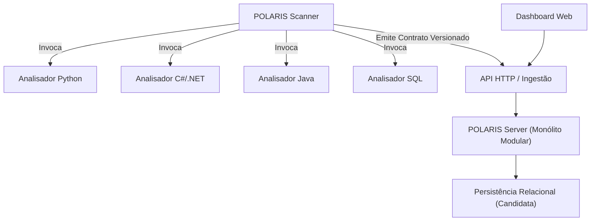

# Arquitetura de Containers e Avaliação de Alternativas

## 1. Arquitetura Candidata Recomendada

1. **POLARIS Scanner (CLI):** Orquestra descoberta de arquivos, aplicação de escopo, seleção de analisadores e envio/armazenamento de resultados.
2. **Analisadores Especializados por Linguagem:** Módulos autônomos para Python, C# / .NET, Java e SQL.
3. **Contrato Normalizado de Resultados:** Esquema versionado independente dos analisadores.
4. **POLARIS Server (Monólito Modular):** Núcleo central com módulos isolados por responsabilidade.
5. **Persistência Relacional (Candidata):** Armazenamento transacional de projetos, análises, issues, métricas e auditoria.
6. **API HTTP Local:** Interface programática versionada.
7. **Dashboard Web:** Interface visual local para consulta e governança.

## 2. Avaliação de Alternativas

### 2.1 Organização do Servidor
- **Monólito Tradicional:** Simples inicialmente, mas tende a acoplamento forte entre domínios.
- **Monólito Modular (Recomendado):** Mantém implantação única local sem complexidade distribuída, preservando limites rígidos entre módulos.
- **Arquitetura Distribuída / Microsserviços:** Rejeitada para a V2.x por introduzir latência de rede, complexidade operacional e necessidade de orquestração desnecessária.

### 2.2 Execução dos Analisadores
- **Analisadores no Mesmo Processo:** Menor overhead de IPC, mas menor isolamento de falhas e dependência de runtime único.
- **Analisadores Independentes (Processos Isolados):** Maior isolamento de falhas, memória e segurança (essencial para código não confiável), permitindo escolher a melhor tecnologia por ecossistema.
- **Modelo Híbrido (Recomendado):** Contrato único de integração permitindo execução isolada por processo para analisadores externos/pesados e execução direta quando seguro e determinístico.
