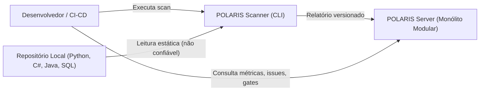

# Contexto do Sistema — POLARIS 2.0

> [!NOTE]
> Este documento descreve a **arquitetura proposta** no `GOAL-002`. Nenhuma funcionalidade foi implementada e nenhuma stack tecnológica foi aprovada.

## 1. Auditoria Inicial do GOAL-001

A revisão dos artefatos do `GOAL-001` confirmou:
- **22 Requisitos Funcionais** (`REQ-FUNC-001` a `REQ-FUNC-022`), **13 Requisitos Não Funcionais** (`REQ-NFR-001` a `REQ-NFR-013`), **12 Jornadas de Usuário** (`UJ-001` a `UJ-012`) e **47 Critérios de Aceitação** estão consistentes e rastreados.
- **Versão de Referência Corrigida:** Identificada explicitamente como **SonarQube Server 2026.5 LTA** (substituindo a referência genérica `latest`).
- **Propostas de Complementação:** Detalhar contratos de fingerprinting de issues, estados parciais de análise (erro de parsing vs falha de analisador) e isolamento de ferramentas de build (MSBuild/Maven/Gradle) — todos endereçados nesta arquitetura.
- **Decisão Pendente para Aprovação Humana:** Confirmação formal da edição comercial de referência (Community Build + recursos selecionados da Developer Edition).

## 2. Diagrama de Contexto (Proposto)

