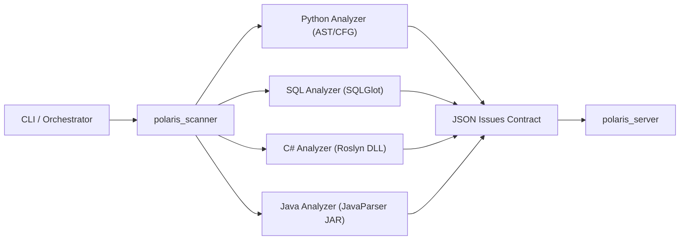

# POLARIS — Architecture AS-IS (Fase 18)

## Estilo Arquitetural
Monólito modular com separação explícita entre Scanner (`src/polaris_scanner`), Server (`src/polaris_server`) e Analisadores Especializados (`analyzers/{python,csharp,java,sql}`).

